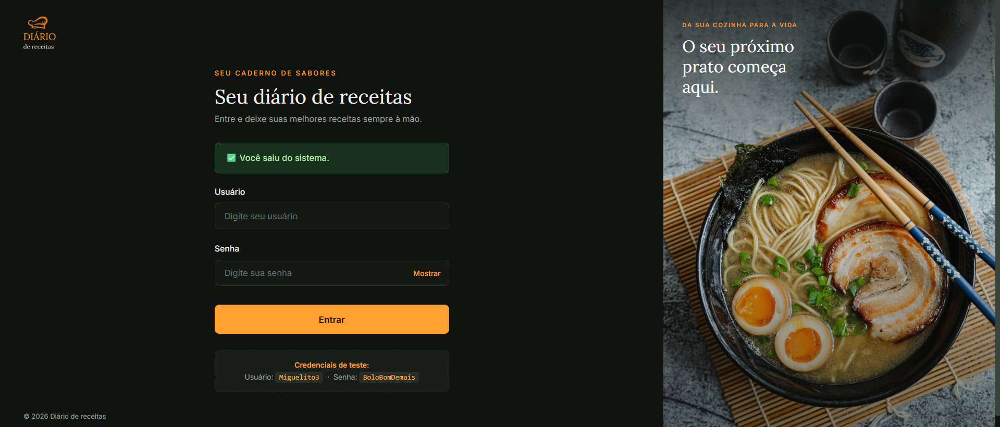
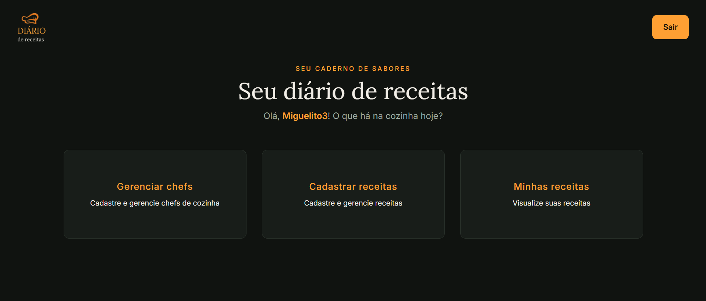
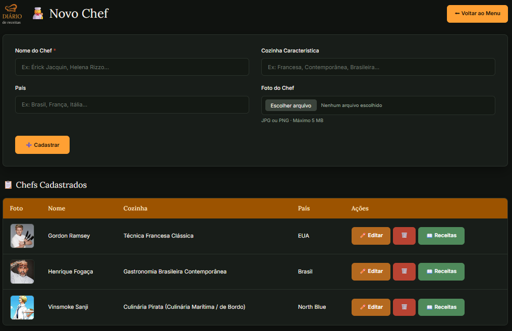
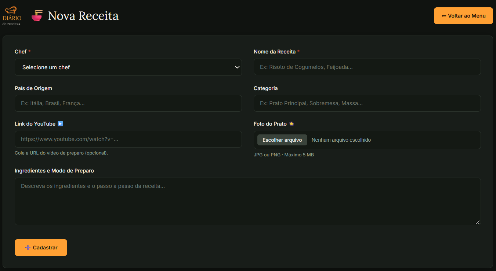
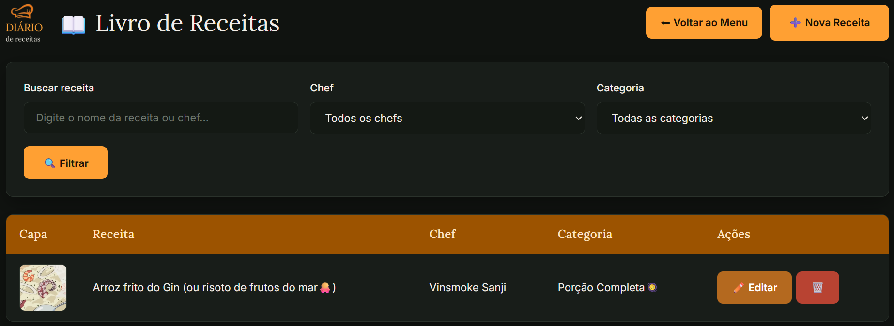

<h1 align="center">📔 Diário de Receitas — Seu caderno de sabores</h1>

  <em>"Cada receita conta uma história. Preserve seus sabores favoritos."</em> 𓆩♫𓆪

    

  
  
  
  

   

  
  
  

---

<h2>◈ Sobre o Projeto</h2>

O <strong>Diário de Receitas</strong> é uma aplicação web desenvolvida como parte das atividades acadêmicas do curso Técnico em Desenvolvimento de Sistemas do <strong>SENAI A. Jacob Lafer</strong>, pela turma <strong>1ID-DS</strong>, na disciplina de <strong>Programação Back-end (PWBE)</strong>.

O projeto tem como proposta desenvolver uma solução digital capaz de centralizar e facilitar o gerenciamento de receitas culinárias e chefs de cozinha.

A plataforma substitui registros manuais por um ambiente digital organizado, permitindo cadastrar, editar, consultar e excluir informações de maneira prática e intuitiva.

Além de preservar receitas e seus respectivos autores, o sistema oferece recursos de pesquisa, filtros de organização, armazenamento de imagens e integração com vídeos do YouTube.

<strong>Mais do que um simples cadastro, o Diário de Receitas é um espaço para organizar, preservar e compartilhar o universo da gastronomia.</strong>

<h2>◈ Demonstração do Projeto</h2>

Confira algumas das principais interfaces desenvolvidas para o Diário de Receitas.

  <h3>01. Tela de Login</h3>

  

  Interface de autenticação e acesso ao sistema.

     

  <h3>02. Menu Principal</h3>

  

  Painel inicial com acesso às principais funcionalidades.

     

  <h3>03. Gerenciamento de Chefs</h3>

  

  Cadastro, consulta e gerenciamento dos chefs de cozinha.

     

  <h3>04. Cadastro de Receitas</h3>

  

  Registro de receitas, ingredientes, modo de preparo e informações complementares.

     

  <h3>05. Livro de Receitas</h3>

  

  Visualização, pesquisa, filtragem e gerenciamento das receitas.

<h2>◈ Funcionalidades</h2>

<h3>01. Autenticação e Controle de Acesso</h3>

<ul>
  <li>Tela de login para acesso ao sistema.</li>
  <li>Validação de usuário e senha.</li>
  <li>Gerenciamento de sessões.</li>
  <li>Proteção das páginas internas.</li>
  <li>Encerramento de sessão.</li>
</ul>

<h3>02. Gerenciamento de Chefs</h3>

<ul>
  <li>Cadastro de chefs de cozinha.</li>
  <li>Registro de nome, cozinha característica e país de origem.</li>
  <li>Upload de fotografias dos profissionais.</li>
  <li>Edição de informações cadastradas.</li>
  <li>Exclusão de registros.</li>
  <li>Consulta das receitas associadas a cada chef.</li>
</ul>

<h3>03. Gerenciamento de Receitas</h3>

<ul>
  <li>Cadastro de novas receitas.</li>
  <li>Associação entre receitas e seus respectivos chefs.</li>
  <li>Registro de nome, país de origem e categoria.</li>
  <li>Armazenamento de ingredientes e modo de preparo.</li>
  <li>Upload de imagens dos pratos.</li>
  <li>Integração com links de vídeos do YouTube.</li>
  <li>Edição e exclusão de receitas.</li>
</ul>

<h3>04. Consulta e Organização</h3>

<ul>
  <li>Listagem das receitas cadastradas.</li>
  <li>Pesquisa por nome da receita ou chef.</li>
  <li>Filtro por chef responsável.</li>
  <li>Filtro por categoria culinária.</li>
  <li>Visualização das informações e imagens dos pratos.</li>
</ul>

<h2>◈ Tecnologias e Ferramentas</h2>

<table align="center">
  <thead>
    <tr>
      <th>Tecnologia / Ferramenta</th>
      <th>Aplicação no Projeto</th>
    </tr>
  </thead>
  <tbody>
    <tr>
      <td><strong>PHP</strong></td>
      <td>Lógica de programação back-end, processamento de formulários e gerenciamento das informações.</td>
    </tr>
    <tr>
      <td><strong>MySQL</strong></td>
      <td>Banco de dados para armazenamento e gerenciamento dos registros.</td>
    </tr>
    <tr>
      <td><strong>HTML5</strong></td>
      <td>Estruturação das páginas da aplicação.</td>
    </tr>
    <tr>
      <td><strong>CSS3</strong></td>
      <td>Estilização e identidade visual da plataforma.</td>
    </tr>
    <tr>
      <td><strong>Visual Studio Code</strong></td>
      <td>Ambiente utilizado para desenvolvimento e edição do código.</td>
    </tr>
    <tr>
      <td><strong>Figma</strong></td>
      <td>Prototipação e planejamento visual da interface.</td>
    </tr>
    <tr>
      <td><strong>Microsoft Word</strong></td>
      <td>Elaboração da documentação acadêmica seguindo as normas ABNT.</td>
    </tr>
  </tbody>
</table>

<h2>◈ Prototipação — Figma</h2>

Antes da implementação, a interface do Diário de Receitas foi planejada e prototipada no Figma, permitindo organizar os elementos visuais e definir a experiência de navegação.

  

    

  <em>Explore o planejamento visual do Diário de Receitas.</em>

<h2>◈ Banco de Dados</h2>

O projeto utiliza o <strong>MySQL</strong> para armazenar e organizar as informações da aplicação.

O banco de dados utilizado é denominado <code>livro_receitas</code> e possui as seguintes tabelas:

<table>
  <thead>
    <tr>
      <th>Tabela</th>
      <th>Responsabilidade</th>
    </tr>
  </thead>
  <tbody>
    <tr>
      <td><code>usuarios</code></td>
      <td>Armazenamento dos dados de acesso ao sistema.</td>
    </tr>
    <tr>
      <td><code>chefs</code></td>
      <td>Registro e gerenciamento dos profissionais da cozinha.</td>
    </tr>
    <tr>
      <td><code>receitas</code></td>
      <td>Armazenamento das receitas e suas respectivas informações.</td>
    </tr>
    <tr>
      <td><code>favoritos</code></td>
      <td>Estrutura destinada ao relacionamento entre usuários e receitas favoritas.</td>
    </tr>
  </tbody>
</table>

As receitas possuem relacionamento com os chefs responsáveis por sua autoria, permitindo identificar e organizar os profissionais associados a cada prato.

<h2>◈ Estrutura do Projeto</h2>

<pre>
Sistema_Receita/
│
├── assets/
│   ├── logo.png
│   └── login-hero.jpg
│
├── img/
│   └── imagens dos chefs e receitas
│
├── docs/
│   └── prints/
│       ├── 01-login.png
│       ├── 02-menu-principal.png
│       ├── 03-gerenciamento-chefs.png
│       ├── 04-cadastro-receitas.png
│       └── 05-livro-receitas.png
│
├── bd1.sql
├── conexao.php
├── login.php
├── logout.php
├── valida_sessao.php
├── index.php
├── cadastro_chef.php
├── cadastro_receita.php
├── listagem_receitas.php
├── geraSenha.php
├── teste_conexao.php
└── styles.css
</pre>

<h2>◈ Como Executar o Projeto</h2>

Para executar o Diário de Receitas localmente, é necessário possuir PHP, MySQL e um servidor Apache.

<h3>01. Clonar o Repositório</h3>

<pre>
git clone URL_DO_REPOSITORIO
</pre>

<h3>02. Configurar o Ambiente</h3>

<ul>
  <li>Instale o XAMPP ou outro ambiente equivalente.</li>
  <li>Inicie os serviços Apache e MySQL.</li>
  <li>Coloque a pasta do projeto dentro do diretório <code>htdocs</code>.</li>
</ul>

<h3>03. Importar o Banco de Dados</h3>

<ul>
  <li>Acesse o phpMyAdmin.</li>
  <li>Importe o arquivo <code>bd1.sql</code>.</li>
  <li>Verifique a criação do banco de dados <code>livro_receitas</code> e suas respectivas tabelas.</li>
</ul>

<h3>04. Configurar a Conexão</h3>

Abra o arquivo <code>conexao.php</code> e configure as credenciais de acordo com seu ambiente MySQL.

<pre>
$servername = "localhost";
$username   = "root";
$password   = "SUA_SENHA";
$dbname     = "livro_receitas";
</pre>

<h3>05. Acessar a Aplicação</h3>

Com os serviços Apache e MySQL em execução, abra o navegador e acesse:

<pre>
http://localhost/Sistema_Receita/
</pre>

<h2>◈ Equipe de Desenvolvimento</h2>

Projeto desenvolvido colaborativamente pelos integrantes:

<table>
  <tr>
    <td align="center"><strong>Caline Myrella Lorena Ramos</strong></td>
  </tr>
  <tr>
    <td align="center"><strong>Enzo Ferrari Lima</strong></td>
  </tr>
  <tr>
    <td align="center"><strong>Gabriel de Araujo Torres</strong></td>
  </tr>
  <tr>
    <td align="center"><strong>Gustavo Silva Cruz</strong></td>
  </tr>
  <tr>
    <td align="center"><strong>Miguel Augusto Porto Coutinho</strong></td>
  </tr>
  <tr>
    <td align="center"><strong>Tainá Alves Silveira</strong></td>
  </tr>
</table>

<h2>◈ Informações Acadêmicas</h2>

<table>
  <tr>
    <td><strong>Instituição</strong></td>
    <td>SENAI A. Jacob Lafer</td>
  </tr>
  <tr>
    <td><strong>Curso</strong></td>
    <td>Técnico em Desenvolvimento de Sistemas</td>
  </tr>
  <tr>
    <td><strong>Turma</strong></td>
    <td>1ID-DS</td>
  </tr>
  <tr>
    <td><strong>Disciplina</strong></td>
    <td>Programação Back-end (PWBE)</td>
  </tr>
  <tr>
    <td><strong>Projeto</strong></td>
    <td>Diário de Receitas</td>
  </tr>
  <tr>
    <td><strong>Modalidade</strong></td>
    <td>Trabalho acadêmico em equipe</td>
  </tr>
  <tr>
    <td><strong>Cidade</strong></td>
    <td>Santo André — SP</td>
  </tr>
</table>

<h2>◈ Objetivo Educacional</h2>

O desenvolvimento deste projeto tem como objetivo aplicar, na prática, os conhecimentos adquiridos durante as aulas de Programação Back-end.

Por meio da construção da aplicação, foram trabalhados conceitos como:

<ul>
  <li>Desenvolvimento de aplicações web com PHP.</li>
  <li>Integração entre PHP e MySQL.</li>
  <li>Modelagem e manipulação de bancos de dados relacionais.</li>
  <li>Operações CRUD (Create, Read, Update e Delete).</li>
  <li>Relacionamentos entre tabelas.</li>
  <li>Validação e processamento de formulários.</li>
  <li>Controle de sessões e autenticação.</li>
  <li>Organização e estilização de interfaces com CSS.</li>
</ul>

<h2>◈ Atividade Acadêmica</h2>

Projeto desenvolvido como atividade acadêmica da disciplina de <strong>Programação Back-end (PWBE)</strong>, no curso Técnico em Desenvolvimento de Sistemas do SENAI A. Jacob Lafer.

A proposta consiste na criação de uma aplicação web funcional, utilizando conceitos de programação, integração com banco de dados e desenvolvimento de sistemas para solucionar uma necessidade de organização e gerenciamento de informações.

<h2>◈ Autoria</h2>

Desenvolvido colaborativamente pela equipe da turma <strong>1ID-DS</strong>, contemplando planejamento, prototipação, desenvolvimento, integração com banco de dados e documentação da aplicação.

Todos os integrantes contribuíram para a construção da solução proposta.

<h2>◈ Rodapé</h2>

  <em>"Boas receitas merecem ser lembradas. Bons projetos merecem ser compartilhados."</em>

    

  <!-- ESPAÇO RESERVADO PARA O GIF DO PROJETO -->

  

    

  <h3>DIÁRIO DE RECEITAS</h3>

  <code>PHP</code> • <code>MySQL</code> • <code>HTML5</code> • <code>CSS3</code>

    

  Desenvolvido com dedicação, criatividade e uma pitada de código.

   

  Projeto acadêmico — SENAI A. Jacob Lafer | Turma 1ID-DS

    

  𓆩♫𓆪

